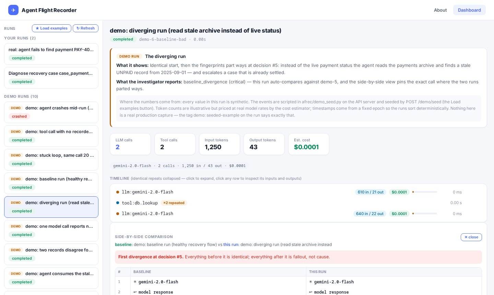
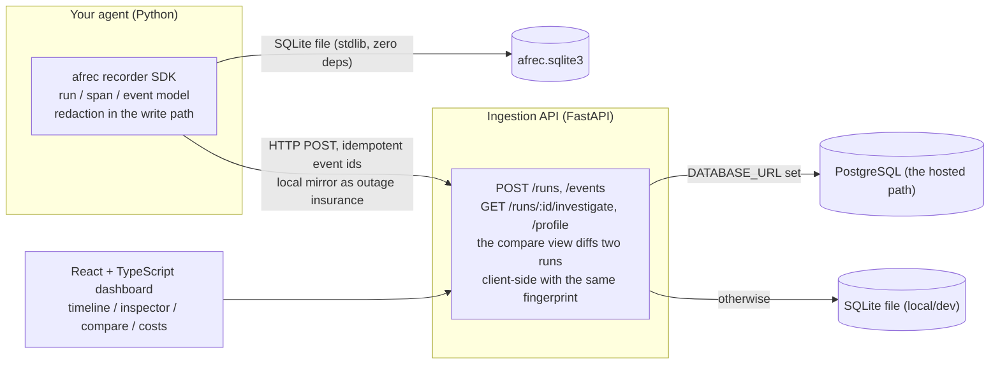

# Agent Flight Recorder

[](https://github.com/aman462006/agent-flight-recorder/actions/workflows/ci.yml)
[](LICENSE)

**A flight recorder for AI agents: record every model call, tool use and
result as a trace, then find the exact step where a run went wrong — by
rule-based diagnosis, baseline comparison, or replay.**

Try the live dashboard: **https://agent-flight-recorder-tsd3.vercel.app**
(canonical deployment; the API runs at
https://afrec-api.onrender.com). Ten seeded demo runs are one click away
("Load examples"), including a real captured failure from a live Groq
agent.

| | |
|---|---|
|  |  |

*Left: the compare view pinning the first divergence between a healthy
run and a broken one. Right: clicking a run auto-runs the investigator,
then compare opens side-by-side.*

**Why it exists:** an agent that returns a polished answer containing a
wrong number is unfalsifiable from the outside. You need the complete
execution history — the model decisions, the tool results (including the
irrelevant or stale ones), and the moment a good run and a bad run
diverged — to say *where* it went wrong, not just *that* it did.

## Quickstart (2 minutes)

```bash
git clone https://github.com/aman462006/agent-flight-recorder
cd agent-flight-recorder
pip install -e . && pip install pytest fastapi uvicorn

# record a run (deterministic demo agent, no API keys, no cost)
python -m demo_agent.agent

# ask the investigator what it thinks of the failure mode
python -m demo_agent.diagnose          # in-process: rules + findings + evidence

# serve the dashboard + API locally and look at the trace
uvicorn api.main:app --reload          # http://localhost:8000/dashboard/
```

Instrument your own agent:

```python
from afrec import get_recorder

rec = get_recorder()  # AFREC_DB env var sets the SQLite path

with rec.run("Compare three solar companies") as run:
    with run.llm_call("gpt-4o-mini", messages) as llm:
        response = model(messages)
        llm.result(response.text, input_tokens=response.usage.input,
                   output_tokens=response.usage.output)

    with run.tool_call("search", {"query": "solar companies india"}) as tool:
        results = do_search(...)
        tool.result(results)   # stale/irrelevant results are captured too — that's the point
```

To stream to the hosted API instead of a local file, point the store at it
and every event posts as it happens (a local SQLite mirror keeps the run
even if the network dies — see "Streaming real agents" below):

```bash
export AFREC_API_URL=https://afrec-api.onrender.com   # or your own deployment
# get_recorder() now streams everything as it happens
```

## Architecture



- **Recorder SDK** (`afrec/`): run/span/event model, SQLite store, HTTP
  streaming store, redaction, crash-safe partial runs, honest cost
  estimation (unknown usage stays unknown, never 0.0).
- **Ingestion API** (`api/main.py`, FastAPI): validation, idempotent
  upserts, the twelve-rule investigator, the profiler, earliest-divergence
  diff.
- **Dashboard** (`dashboard/`, React + TypeScript): run list, span
  timeline (repeats collapse to ×N rows), event inspector, side-by-side
  compare, per-run and per-model cost.
- **Storage**: PostgreSQL when `DATABASE_URL` is set (what the hosted demo
  runs), SQLite otherwise. Same SQL shape either way.
- **CI**: GitHub Actions runs pytest (which pins the benchmark and
  held-out results), the benchmark, the held-out set, and the dashboard
  type-check/tests/build on every push and PR.

## What "replay" means here, precisely

Recorded tool outputs are replayed, not re-executed. Concretely:

```python
from afrec.replay import replay_deterministic

report = replay_deterministic(events, agent_fn)
# report["faithful"]  True if agent_fn made exactly the recorded calls
# report["misses"]    the first moment the live code asked for anything
#                    the recorded run never did — that is the divergence
```

`replay_deterministic` runs *your* agent function with every tool call
answered from the recorded trace — no LLM, no network, no side effects.
If the replayed code makes the exact same calls in the same order, the
run is **faithful**; the moment it asks for anything unrecorded, the
replay stops and reports the divergence. It is a determinism check on
your agent's decision logic, plus the substrate for the baseline diff:
two recorded runs are fingerprinted decision-by-decision
(model calls on messages, tool calls on arguments) and the earliest
divergence is pinned.

## The failure investigator

`GET /runs/{id}/investigate` runs twelve deterministic rules over a
trace. Every finding separates what the trace *observed* from the
investigator's *hypothesis*, and carries verbatim evidence excerpts:

```
critical  baseline_divergence — earliest divergence from baseline at
          decision #5: tool_call_changed — agent chose a different tool
          or arguments
          evidence: {"label": "tool:calculator", "arguments": {"expression": "2100 + 0"}}
warning   conflicting_records — tool results disagree for entity
          'Vikram Solar': year = 2022 (…), 2025 (…)
          Hypothesis: one of these records is stale and the agent may
          have consumed the older value without re-verifying
```

Rules include: crash and error events, unclosed spans, tool calls with
no recorded result, the token-burning loop (repeated_decision),
conflicting records, stale_consumption, empty_search_conclusion,
token capture gaps, and baseline divergence. The full list with
semantics lives in `afrec/investigator.py`'s rule catalogue comment.

The honest limitation, tested and documented: the bad run *alone* can
look clean to single-run rules, because the fresh figure never entered
its trace. What exposes it is the baseline diff. Single-run heuristics
are not enough — that is why replay and diff exist.

## Results, three tiers, stated honestly

Three different things live here, and conflating them is how evals lie.

### 1. Synthetic regression suite (`python -m bench.run_benchmark`)

121 seeded scenarios (40 clean, 81 scripted failures across 9 types):

| Metric | Measured (seed 42, stable across seeds 7 and 99) |
|---|---|
| Failures fully detected | 81/81 |
| Clean runs reported clean | 40/40 (0 false-positive findings) |
| Per-type precision | 1.00 |

Read this honestly: the failures are scripted by the same author who
wrote the rules, so a perfect score only verifies that the rules fire as
designed. It is a regression suite. It says nothing about real-world
accuracy, and this README does not pretend otherwise. Thresholds are
pinned in `tests/test_benchmark.py`, so a regression fails CI, not the
demo.

### 2. Held-out adversarial set (`python -m bench.run_heldout`)

Written *after* the rules were frozen, specifically to break them:
7 legitimate behaviours that look like failure shapes (near-miss
precision probes) and 4 genuine failures in shapes the rules were not
designed for (near-miss recall probes). The builders share no helpers
with the synthetic suite. Outcomes are pinned in
`tests/test_heldout.py` — an improvement is a deliberate, visible
commit, and so is a regression.

| Metric | Measured (2026-10-17) |
|---|---|
| Clean near-misses stayed silent (warning level) | 6/7 |
| False positive: `repeated_decision` on legitimate same-args polling where the *results* change (s07) | 1 |
| Subtle failures caught | 1/4 |
| Precision / recall on this set (warning level) | 0.50 / 0.25 |

**Known misses, by id, with the shape that defeats the rule:**

- `f08` — a real stuck loop, but interleaved with LLM "thinking" so
  identical calls are never consecutive; the consecutive-run rule can't
  see interleaved loops.
- `f10` — wrong-record consumption: the answer uses customer B's balance
  for customer A. No rule was written for this shape.
- `f11` — the record *was* found by an earlier lookup, but the agent
  still answers "couldn't locate" after an empty search;
  `empty_search_conclusion` requires all evidence to be empty.

This set exists to find these gaps, not to hide them. The rules were
not re-tuned after seeing these results; the misses are the roadmap.

### 3. Real agents, human labels (`bench/real/`)

A tool-using agent (search + calculator) runs 30 varied tasks against a
real LLM (Groq `qwen/qwen3.8-27b` via REST; Gemini as fallback; the key
comes from the environment, never the repo). Every trace is saved, a
**human labels each one success/failure** (`python -m bench.real.label`,
nothing auto-labels), and `python -m bench.real.evaluate` scores the
unchanged investigator against those labels, reporting every miss and
false positive by trace id.

Current measured state (30 traces, all labelled by hand):

```
                      flagged by investigator   clean
human said FAILURE              2                  1   <- recall 67%
human said SUCCESS              0                 27
precision (of flags): 100%   |   recall (of failures): 67%

MISSES (human failure, investigator clean):
  r03 [stale_data]
```

Honest disclosure: the `stale_consumption` and `empty_search_conclusion`
rules were *written after* reviewing these labels, so this tier is
partly in-sample — the held-out set above is the out-of-sample one.
The remaining miss (r03) may itself be a labelling question: the answer
cites the freshest corpus value, and it is flagged for human review.

### Bonus: a real captured failure, on the dashboard

`scripts/capture_real_failure.py` points a live agent (Groq
`gpt-oss-20b`) at a ledger record that does not exist. The first capture
exposed a real rule gap — the agent answered with a curly-apostrophe
"couldn't locate" that the unavailability regex missed. The regex now
meets that phrasing, with a regression test built from the exact
captured sentence. The run is on the hosted dashboard as
"real: agent fails to find payment PAY-404".

## Why not Langfuse / LangSmith / Phoenix?

All three are good tools. If you need a production observability platform,
use one of them. This project exists for a narrower job, and there are
three things it does that they don't, as of writing:

- **Diff-first baseline comparison.** The replay mode re-executes a
  recorded run and diffs it against a stored baseline event-by-event.
  "What changed between the version of the agent that worked and the one
  that doesn't" is a file-level `diff` away, not a dashboard exercise.
- **Evidence-linked rule diagnosis.** The investigator rules don't just
  flag a run as bad, they cite the exact span/event that proves the
  finding. A score tells you a run failed; the cited evidence tells you
  where to look.
- **Nothing to run.** One pip install, one SQLite file, zero servers.
  Langfuse self-hosting is a Docker + Postgres stack; LangSmith is
  hosted-only; Phoenix is lighter but still a service with a UI to keep
  alive. This is a file and a stdlib HTTP API.

What they do better, plainly:

- **Scale and durability.** They are built on real databases for
  millions of traces, teams, and access control.
- **Analytics and collaboration.** Dashboards, trends, prompt
  management, experiment tracking, alerting, SSO. None of that is here
  and most of it isn't planned.
- **Ecosystem.** OpenInference/integration coverage for every framework.
  Here you install the SDK and call `recorder.run(...)`.

Use this to debug your agent. Use them to run observability for an
organization.

## Limitations

- **The investigator is rule-based, not learned.** The rules encode
  known failure shapes (stale data, unused results, contradicting
  values, loops). They say nothing about failure shapes nobody wrote
  down. The held-out and real-agent evaluations above exist precisely
  to measure what the rules miss — currently 3 of 4 held-out recall
  probes and 1 of 3 human-labelled failures.
- **Single-process, single-user.** No auth, no multi-tenant isolation,
  no ingestion sharding. One process, one store.
- **SQLite loses data on ephemeral hosting.** On serverless platforms the
  store lives in `/tmp` and is wiped between cold starts. Point
  `DATABASE_URL` at Postgres (what the hosted deployment does) or run
  the API on a long-lived host if you want data to survive.
- **Regex redaction is narrow by design** (see Security).
- **No alerting, no analytics, no team features.** It records,
  investigates, diffs. That is the whole product.

## Security, honestly

- **The hosted instance has no authentication and no per-user scoping.**
  Anyone who can reach the API can read and write runs. Treat it as a
  demo. For real data, self-host and put it behind your own auth.
- **Redaction is key-name and regex based, and it is narrow.** Covered:
  event/dict keys named `api_key`, `apikey`, `authorization`,
  `password`, `secret` (value fully masked), plus string patterns for
  OpenAI-style keys (`sk-…`), `Bearer` tokens, and `api_key=…` /
  `password=…` assignments. Not covered: arbitrary PII (names, emails,
  phone numbers, addresses) and secret formats that don't match the
  known shapes — a bespoke JWT, a database URL with credentials, or a
  password in a sentence will pass through. Redaction happens in the
  persistence path, so what is on disk/wire is redacted — but what it
  can redact is a fixed, small list.
- **Costs are estimated, not billed numbers**, and only when the
  provider reports usage; unknown usage is reported as unknown.

## Streaming real agents to the live API

`afrec.HttpStore` streams runs to an ingestion API as they happen — the
drop-in way to record a real provider call (Gemini, OpenAI, Groq, ...)
and watch it on the dashboard:

```python
from afrec import HttpStore, get_recorder

rec = get_recorder(store=HttpStore("https://afrec-api.onrender.com"))

with rec.run("live agent call") as run:
    # ... same span/event API as above ...
    pass

rec.store.flush(timeout=30)
```

Design guarantees (tested in `tests/test_http_store.py`):

1. **Instrumentation never breaks the agent.** Posts run on a background
   thread; a dead API is counted and warned, never raised into your loop.
2. **An outage never loses a trace.** Every event also writes to a local
   SQLite mirror (`$AFREC_DB`), so the recording survives network
   failure — and `scripts/replay_mirror.py` re-posts the mirror's runs
   idempotently when the API comes back.
3. **Secrets stay in-process.** Data is redacted before it goes on the wire.
4. **Retries are idempotent.** Client-side event IDs de-duplicate retries.

Full runnable example: `python -m examples.gemini_agent` (needs
`google-genai` and a `GEMINI_API_KEY`).

## Deployment

The canonical deployment:

- Dashboard: **https://agent-flight-recorder-tsd3.vercel.app**
  (Vercel, builds from `dashboard/`)
- API: **https://afrec-api.onrender.com** (Render, `uvicorn api.main:app`)
- Storage: PostgreSQL via `DATABASE_URL` (Neon free tier). Health check:
  `GET /health` reports `"db": "postgres"`. Without `DATABASE_URL` the
  API writes SQLite — fine locally, wrong on ephemeral hosting.

Self-hosting the whole stack is deliberately boring:
`pip install -e ".[dev]" && uvicorn api.main:app` serves the API and the
built dashboard; a `DATABASE_URL` is the only production-must.

## Tests and CI

```bash
python -m pytest tests/ -q          # backend: rules, API, SDK, benchmark + held-out pins
python -m bench.run_benchmark      # synthetic suite, thresholds pinned in tests
python -m bench.run_heldout        # adversarial held-out set, outcomes pinned in tests
cd dashboard && npx tsc --noEmit && npx vitest run && npm run build
```

CI (`.github/workflows/ci.yml`) runs all of the above on every push and
PR; the badge at the top of this README is that workflow. The test
counts are not hardcoded here on purpose — run the suite or read the
badge; stale numbers in prose are how READMEs lie.

## Stack

Python SDK + SQLite/Postgres · FastAPI ingestion API (`api/main.py`)
· React + TypeScript dashboard (`dashboard/`) · pytest + vitest ·
Render + Vercel for the hosted deployment · MIT licensed.

## Repository layout

```
afrec/          recorder SDK: models, SQLite store, HTTP store, redaction,
                replay + diff, investigator (12 rules), profiler
api/            FastAPI ingestion API + demo seeding endpoints
dashboard/      React + TypeScript dashboard (Vite)
demo_agent/     deterministic zero-cost demo agent with a planted failure
bench/          synthetic benchmark, held-out adversarial set, real-agent
                evaluation (collect / human-label / evaluate)
scripts/        dashboard capture + verify, real-failure capture, mirror replay
tests/          pytest suite incl. benchmark and held-out pins
docs/           screenshots, deployment notes
```
